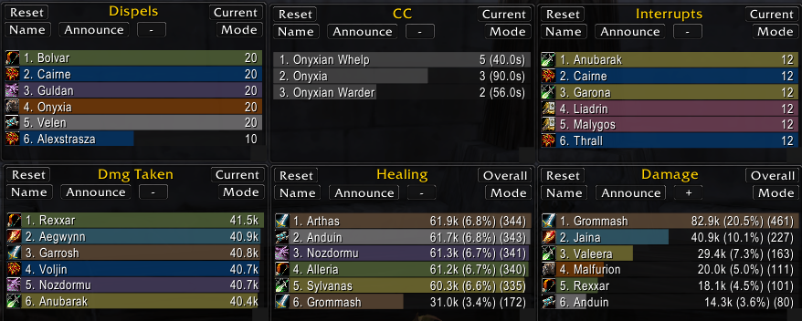
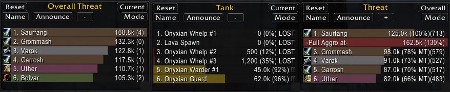
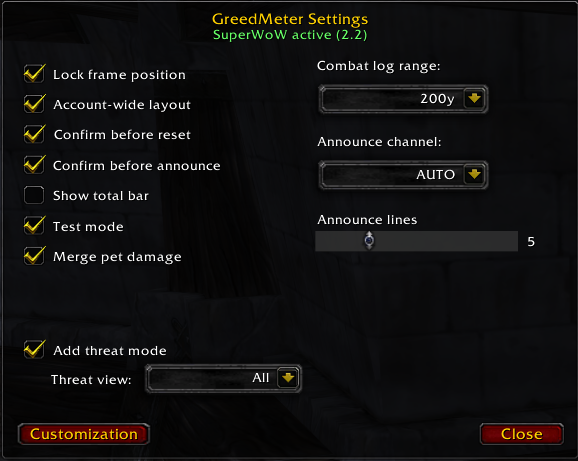
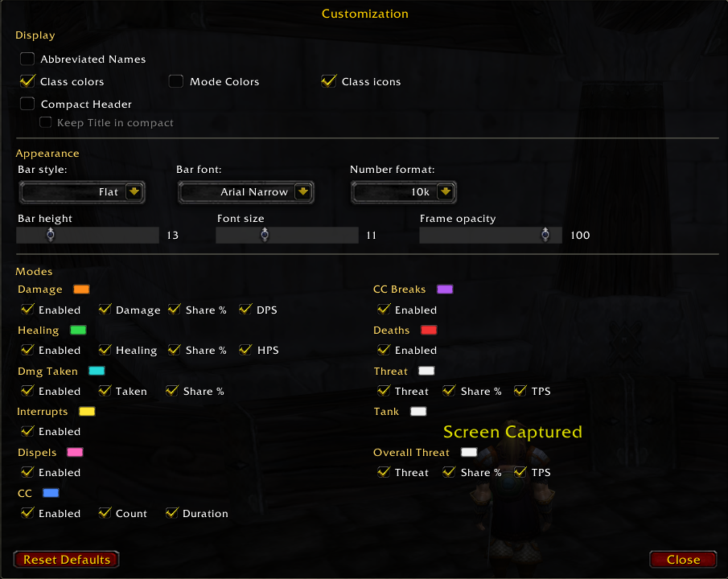

# GreedMeter

A lightweight combat meter for Vanilla 1.12 / Turtle WoW.

GreedMeter tracks damage, healing (including absorbs), dispels, interrupts, hard CCs, CC breaks, damage taken, deaths, and threat. It works on stock 1.12 clients and automatically uses optional client mods when present for structured combat events, GUID-based pet/totem ownership, and melee-range aggro thresholds.

## Client Mods Used

| Mod | Purpose in this addon | Required? |
|---|---|---|
| **ClassicAPI** | Event-driven nameplate threat glow (`C_NamePlate`, `NAME_PLATE_UNIT_ADDED` / `NAME_PLATE_UNIT_REMOVED`) | Optional |
| **Nampower** | Structured combat events (`AUTO_ATTACK_*`, `SPELL_DAMAGE_EVENT_*`, `SPELL_MISS_*`, `SPELL_HEAL_BY_*`, `SPELL_DISPEL_BY_*`, `DAMAGE_SHIELD_*`, `AURA_CAST_*`, `DEBUFF_*`, `ENVIRONMENTAL_DMG_*`, `UNIT_DIED`) and `GetSpellRecField` | Optional |
| **SuperWoW** | `RAW_COMBATLOG` fallback (when Nampower is absent), GUID unit resolution, `<guid>owner` pet/totem attribution, and `TargetUnit(guid)` threat targeting | Optional |
| **UnitXP SP3** | `meleeAutoAttack` distance check for accurate 110% vs 130% pull-aggro thresholds in estimated threat mode | Optional |
| **CombatHub** | Optional shared combat event coordinator (`Parser\Adapter_CombatHub.lua`) that shares a single Nampower event stream across compatible addons | Optional |

## Features

* **Multiple meter windows** – Open extra frames (up to 6) so you can watch Damage, Healing, Interrupts, etc. at the same time
* **Modes** – Damage, Healing, Dispels, Damage Taken, Interrupts, CC, CC Breaks, Deaths, Threat
* **Segments** – Current fight, Overall, recent fights, and recent boss fights
* **Absorbs automatically included in healing**
* **CC tracking** – Lists enemies that were crowd-controlled and any broken CCs (estimated duration)
* **Class icons** – Optional class icons before player names on the bars
* **Combat log range** – Expand beyond the default 40 yards (up to 200) so distant raid members are still tracked
* **Announce** – Report a window to SAY / PARTY / RAID (with optional confirmation)
* **Name filter** – Quickly hide individual players from a window
* **Layout saving** – Position, size, mode, and shown state saved per character (or account-wide if enabled in settings)
* **Minimap button** – Left-click toggle meters, right-click settings, drag to reposition
* **Settings** – Class colors, bar height, font size, opacity, lock frames, Customization and more

## What Was Fixed / Improved

* **Nampower `NP.Available()` detection:** Fixed a false-positive `pcall(GetCVar, ...)` check that returned `true` on stock clients without Nampower.
* **Nampower `SPELL_MISS_*` enum mapping:** Fixed swapped `missInfo` integer codes (`2=Resist`, `3=Dodge`, `4=Parry`, `5=Block`, `6=Evade`, `7/8=Immune`, `9=Deflect`, `10=Absorb`, `11=Reflect`).
* **Nampower damage shields & environmental damage:** Added `DAMAGE_SHIELD_SELF` / `DAMAGE_SHIELD_OTHER` tracking, mapped `ENVIRONMENTAL_DMG_*` integer types (`Exhausted`, `Drowning`, `Fall`, `Lava`, `Slime`, `Fire`, `FallToVoid`), and credited absorbed environmental damage.
* **Nampower pet/totem healing & partial auto-attacks:** Resolved pet/totem healers in `OnSpellHeal()` and passed partial block/resist flags in `OnAutoAttack()`.
* **GUID & pet cache fixes:** Normalized `0x` GUID case across `Parser/API.lua`, prevented `RefreshGuidCacheFromUnits()` from overwriting generic pet names (`Bear`, `Cat`, `Wolf`, `Imp`, etc.) in `OM.heuristicPets`, and added SuperWoW `UnitExists` pet GUID fallback.
* **Combat performance:** Reused GUID tracking tables in `Backend_Nampower.lua`, removed per-hit `fields` table allocation in `OnSpellDamage()`, and cached `name -> unit` tokens for `O(1)` overheal lookups in `FindUnitByName()`.
* **Threat & TOC:** Added optional UnitXP SP3 `meleeAutoAttack` check for estimated pull-aggro thresholds and fixed `Threat.lua` casing in `GreedMeter.toc`.
* **Tank threat-loss alerts:** Added configurable sound and red screen-edge glow alerts when you lose aggro on your current target or when a teammate's threat reaches the configurable `Warn at 2nd threat %` threshold (via `TWTv4=` / `#TMTv1=`).
* **Nameplate threat glow (ClassicAPI):** Added event-driven nameplate threat borders (`C_NamePlate`) that glow red when an in-combat enemy targets someone else and amber when `#TMTv1=` reports a teammate nearing your threat threshold (compatible with both `pfUI` and default nameplates).

## Commands

| Command | What it does |
|---------|--------------|
| `/gdm` or `/gdm show` | Show / hide all meter windows |
| `/gdm set` or `/gdm settings` | Open the settings window |
| `/gdm cust` | Open customization window |
| `/gdm pause` | Freeze meters on a Paused snapshot (toggle) |
| `/gdm reset` | Clear all recorded combat data |
| `/gdm range` | Show current combat log range |
| `/gdm range 200` | Set combat log range to 200 yards |
| `/gdm range 40` | Restore default 40-yard range |
| `/gdm test` | Load fake 40-player raid data for UI testing |
| `/gdm help` | Show this help |

## Credits & License

* Original addon: `iGreed` (MIT License)
